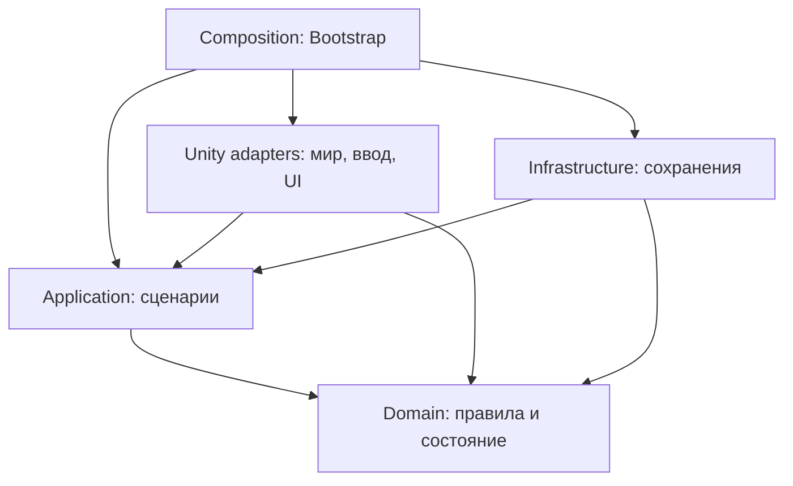

# Архитектура

Статус: базовый план MVP согласован 22.11.2026, см. [решения](decisions.md). Основание: [требования](requirements.md) и GDD §17. В T02 реализованы каркас сцен, управление временной сессией и явная композиция; T03 добавила ввод, движение и паузу и принята владельцем. Остальные системы ниже остаются планом. T01 проверила импорт, новая структура прошла EditMode 6/6 и PlayMode 3/3; сборка нового каркаса остаётся T06. См. [отчёт T02](reports/T02-bootstrap.md).

## 1. Фактическая исходная точка

Репозиторий уже является Unity-проектом: `Assets/Scenes/SampleScene.unity`, URP 2D renderer/settings, стандартный `InputSystem_Actions.inputactions`, `Packages/manifest.json`, `Packages/packages-lock.json`, `ProjectSettings/`. При подготовке SDD игровых C#-скриптов не было. После T02 в Build Settings включены Bootstrap, MainMenu, Gameplay (в таком порядке); SampleScene сохранена как исходный шаблон. Наличие Input Actions ещё не означает настроенное управление игры.

| Компонент | Зафиксировано в проекте | Решение |
|---|---|---|
| Unity Editor | 6000.6.10f1 | Сохранить версию; обновление отдельной задачей с регрессией |
| Язык | C# в среде Unity | Без внешнего .NET runtime и отдельного backend |
| Rendering | URP 17.6.0, Renderer2D | Ортографическая камера и Tilemap. Для игрового арта A09 задаёт 32 PPU и тайл 32 × 32 px на клетку. Эффекты по бюджету устройства |
| Input | Input System 1.20.1 | Общие команды для touch и клавиатуры |
| UI | uGUI 2.6.0 | Canvas + TextMeshPro, HUD/меню/touch; не смешивать два UI-стека без причины |
| Тесты | Unity Test Framework 1.8.0 | EditMode, PlayMode, Android smoke |
| 2D | Tilemap 1.0.0, Tilemap Extras 9.0.1, Animation 16.0.1 | Использовать по необходимости, не устанавливать дополнительные пакеты заранее |
| Версионирование | Git, существующие .gitignore и .gitattributes | Asset + .meta вместе, lock-файл в Git; проверить LFS на первой сборке |

Для Android предложены IL2CPP + ARM64, development APK для телефона, подписанный release AAB при выборе магазина. Это целевая конфигурация, не описание уже настроенного Player Settings. SDK/NDK/OpenJDK — модули соответствующего Editor через Unity Hub. Минимальный API и целевой API фиксируются после Q02 и проверки требований выбранного канала публикации; значение Auto в шаблоне не считается release-контрактом.

## 2. Основные решения

| ADR | Решение | Причина / последствие |
|---|---|---|
| ADR-01 | Модульный монолит Unity, без ECS, сетевого backend, DI-фреймворка | Один герой и до шести врагов не требуют распределённой архитектуры; зависимости собираются явно |
| ADR-02 | Чистое C#-ядро правил + Unity-адаптеры | Урон, прогрессия, покупки и снимки тестируются без сцен; физика/ввод остаются в Unity |
| ADR-03 | ScriptableObject definitions + prefab-композиции комнат | Редактирование контента в Editor; definitions неизменяемы в runtime, состояние отдельно |
| ADR-04 | Одна активная комната внутри Gameplay | Предел памяти/ИИ, единая логика перехода и жизненного цикла; нет 100 независимых сцен с копиями сервисов |
| ADR-05 | Явные три срока жизни состояния | Уникальные награды не восстанавливаются при сбросе блоков; ключевые правила видны в данных |
| ADR-06 | Локальные версионированные снимки, транзакции для прогресса | Надёжность и проверка прерываний; PlayerPrefs только для некритичных настроек, не прогресса |
| ADR-07 | Компактные typed-контракты и прямые зависимости | Нет глобальной шины для всех взаимодействий; события для UI/звука только после применения состояния |
| ADR-08 | Срез `VS-*` и кампания имеют отдельные каталоги и сохранения | Прототипный граф не загрязняет финальные D1-01…12 и уникальные награды |

## 3. Границы модулей и направление зависимостей

Стрелка — compile-time зависимость. `Application` объявляет порты (`ISaveRepository`, `IRoomLoader`, `IGameClock`); Infrastructure/UnityAdapters реализуют их. Обратных зависимостей ядра от реализации нет. Bootstrap создаёт сервисы и передаёт зависимости; контейнер сервисов через статический singleton не нужен.

| Модуль / asmdef (Infrastructure и Editor — план) | Ответственность | Не делает |
|---|---|---|
| AshBeacon.Domain | DamageRules, InventoryState, RewardTransaction, DoorConditions, Progression, reset policies, DTO | Не обращается к GameObject, Physics2D, файлам, UI |
| AshBeacon.Application | NewGame/LoadGame, UseItem, ApplyHits, OpenDoor, Purchase, EnterRoom, BossAttempt; координация транзакций | Не рисует, не сериализует через конкретное API |
| AshBeacon.UnityAdapters | Rigidbody2D/Collider2D, Input Actions, представления героя/врагов/снарядов, камера, UI, звук, RoomLoader, definitions | Не хранит отдельный баланс денег/ключей в HUD |
| AshBeacon.Infrastructure | SaveRepository, DTO serializer, файловая запись/резерв, настройки, диагностика | Не определяет условия победы и цены |
| AshBeacon.Composition | Bootstrap и сборка зависимостей | Не содержит боевые формулы |
| AshBeacon.Editor | Валидатор контента, build entrypoints, удобства authoring | Не попадает в runtime-сборку |

Domain и Application: `noEngineReferences`, независимые от UnityEngine. SO преобразуются в простые definitions/DTO на границе. Сначала минимальные контракты для текущей задачи; не создавать десятки пустых интерфейсов под будущую кампанию.

Спрайты, клипы, Tilemap и uGUI привязываются к представлениям через UnityAdapters, prefab и ссылки в definitions. Состояние героя, фаза атаки и флаги объектов определяют отображаемый кадр. Длительность клипа и контур PNG не задают урон, окно уязвимости или коллайдер. Общие рисунки можно использовать в обоих каталогах с сохранением отдельных ID и профилей VS и campaign. Генератор ИИ работает только при подготовке ресурсов. Стиль определяет [арт-руководство](art-direction.md), путь готового файла до представления — [профиль импорта](asset-pipeline.md).

## 4. Сцены и игровой цикл

`Bootstrap` создаёт один корень жизненного цикла и загружает `MainMenu`. При старте игры создаётся `Gameplay`, в ней только активная комната и её UI. Смена комнаты выгружает её runtime-объекты, оставляя сессию/инвентарь/сохранение. Возврат в главное меню уничтожает gameplay-сессию, но не дублирует сервисы. SampleScene заменяется в build profile только после проверки нового входа.

Глобальные состояния: Boot, MainMenu, Loading, Playing, Paused, Transition, Defeat, Ending. Состояния героя: Idle/Move, Attack, UseItem, Interact, Hurt, Dead. Состояние мира имеет приоритет над локальным. Пауза, диалог, колесо, фон и переход используют владельцев блокировки: закрытие одного меню не снимает паузу другого. UI/анимация перехода используют независимое время; бой, ИИ, ловушки, дроп и cooldown — время симуляции.

Предложение: шаг симуляции 1/60 с (подтверждается профилированием S0). Unity-физика 2D остаётся источником контактов; движение через Rigidbody2D и проверки препятствий, не телепортацию Transform сквозь стены. Конкретный body type фиксируется после прототипа столкновений. Ввод читается каждый render-frame, команды и буфер потребляются на шаге симуляции. Время и RNG внедряются для воспроизводимых тестов.

Обработка одного шага: команды → движение/ИИ → сбор контактов → проверка разрешённых эффектов → агрегация попаданий → изменение HP → разрешение смертей/победы → транзакции прогресса → уведомление представлений. При неоднозначном порядке callbacks контакт сначала записывается, а не немедленно меняет HP; тест доказывает независимость от порядка контактов. Условия щита/уязвимости оцениваются по согласованному состоянию начала разрешения шага. Победа босса разрешается до окончательной смерти героя по FR-27.

Эффект: `ApplicationId`, `SourceId`, `Owner/Faction`, `EffectType`, `Damage`, `Direction`. Меч и его волна делят ID применения; у каждого применения набор поражённых целей. Щит/иммунитет/неуязвимость проверяются до регистрации принятого попадания. Невалидное касание не поглощает будущую разрешённую атаку. Идентификаторы применений временные, ID наград/дверей постоянные.

Урон и физическое толкание разделены слоями WorldSolid, PlayerBody, EnemyBody, PlayerHitbox, EnemyHitbox, Projectile, Trigger, Pickup. В матрице T04 физическое тело игрока и тело врага контактируют с WorldSolid. Меч и снаряды проверяют слои явными запросами, мишень и игрок не толкают друг друга. Воздушные враги обходят только ограничения воды/ям, не стены. Пулы снарядов/VFX полностью очищают hit-history, владельца и подписки при возврате.

В T04 `PlayerCombat` координирует команды, время и защиту героя. `CombatArena` собирает пересечения меча, трассирует вражеские снаряды лучом, проверяет путь волны прямоугольником её видимого размера и разрешает очередь каждого получателя перед шагом Rigidbody2D. `CombatHealth` хранит HP и регистрирует только выигравшее попадание. При равном уроне порядок задают компоненты направления, затем номер создания применения. Одна ссылка на `HitApplication` обозначает взмах для меча и волны. Отбрасывание ограничено sweep тела героя по WorldSolid. Прототип работает на текущем Unity Fixed Timestep 0,02 с, подбор частоты остаётся частью профилирования S0.

## 5. Модель контента и состояния

### Реализовано в T03

`PlayerMovement` (Domain) нормализует движение и хранит четыре направления взгляда с гистерезисом. `PlayerControls` (Application) содержит буфер 0,12 с, удержание меча и независимые причины паузы Menu/ItemWheel/Focus/Background. Время симуляции продвигается явным `Advance`, без Unity и системных часов.

`GameplayController` — локальная композиция проверочной комнаты: создаёт один `PlayerControls`, InputActionMap клавиатуры, связывает `PlayerMotor` и uGUI `TouchControl`. Ссылки назначены в Gameplay; Bootstrap не ищет игровые сервисы глобально. Параметры скорости и тела читаются из `PlayerDefinition.asset`. `PlayerMotor` использует Dynamic Rigidbody2D, linearVelocity в FixedUpdate, gravityScale=0, FreezeRotation, Continuous и временный материал без трения.

Пауза управляет timeScale, UI остаётся на render-frame. Каждый владелец снимает только свой флаг. При блокировке очищаются буферы, пальцы и скорость; после возврата удерживаемая клавиатура должна пройти нейтраль. Выгрузка/отключение Gameplay возвращает исходный timeScale, освобождает InputActionMap и физический материал. Герой/взгляд/ввод имеют reset policy `RoomRuntimeState`, текущая комната живёт одну сессию T02. Сохранения и перенос состояния героя между комнатами появятся в S1.

`SafeAreaView` вписывает мобильные контролы в Screen.safeArea. PlayMode проверяет независимые pointer ID. Результаты прогона на телефоне не зафиксированы. [Спецификация](specs/T03-controls.md), [отчёт](reports/T03-controls.md).

Сохраняются поля definitions из GDD §17. Дополнения для надёжной сборки:

| Сущность | Дополнительный контракт |
|---|---|
| ContentCatalog | ContentSetId (`vertical-slice`/`campaign`), версия контента, уникальные ссылки на definitions |
| RoomDefinition | Границы 20 × 12, валидные spawn/safe points, clear-group, reset policy каждой сущности |
| DoorDefinition | Один DoorId для двух сторон; from/to и условия отдельно для направления открытия короткого пути |
| RewardDefinition | RewardId, состав выдачи, источник, флаг получения; ключ/печать/сердце одним набором |
| PuzzleDefinition | AND/sequence/timed, SwitchIds, TargetIds, reset scope, возможность сброса |
| BossDefinition | Фазы, окна, пороги HP, эффекты, arena resources и ссылка на RewardId |
| SaveEnvelope | schemaVersion, contentSetId, contentVersion, sequence, payload и проверка целостности |

Постоянные ID задаются при authoring и валидируются: `D2-09-CHEST-01`, `D2-02-05-DOOR`, `VS-D1-06-REWARD`. Нельзя использовать instance ID Unity или случайный GUID при запуске. Переименование постоянного ID требует миграции или явного сброса только прототипного профиля.

| Срок жизни | Примеры | Сброс / запись |
|---|---|---|
| Persistent WorldState | Вещи, двери, награды, печати, пьедесталы заработанных ключей, секреты, карта, телепорты | Только новая игра/явная миграция; сериализуется |
| DungeonVisitState / OverworldRefreshState | Зачищенные комнаты, локальные переключатели; история различных внешних экранов | Выход из храма/смерть/загрузка согласно Q05; обновление поверхности по FR-20 |
| RoomRuntimeState | Блоки, временные плиты, timed puzzles, обычные враги/снаряды/дроп | Выход/перезагрузка комнаты; не сериализуется |

У конкретной сущности ровно одна политика. Политика дверей и их переключателей совместно проверяется валидатором. Отдельное правило пьедестала не позволяет потерять уже заработанный ключ при сбросе боя. Не путать четыре сюжетные печати и четыре внутренних переключателя D5: разные типы ID и наборы флагов.

## 6. Транзакции и сохранения

`GameState` — единственный источник прогресса. `SaveData` содержит Player/Inventory, persistent flags, collectedRewardIds, exploredRooms/markers, checkpoint (room + entry + safe point), statistics, bossAttempt и номер схемы. Сериализуется DTO, не GameObject/SO. Для простого встроенного JSON-сериализатора использовать списки записей вместо словарей; сложный сериализатор подключать только при доказанной необходимости.

Команды покупки, открытия ключевой двери, выдачи награды и победы сначала проверяют предусловия, затем строят согласованный новый снимок. Например, открытие двери меняет ключ и DoorId вместе; выдача пьедестала меняет RewardId, печать, maxHP и HP вместе. Очередь записи одна, sequence монотонный; старый снимок не может перезаписать более новый. UI видит применённый результат и статус записи; ошибка записи не выдаётся за успешное сохранение.

Предлагаемый протокол: сериализовать снимок → записать временный файл в том же каталоге `Application.persistentDataPath` → flush/close → проверить формат/целостность → сохранить предыдущий валидный основной как резерв через отдельный temp → атомарно заменить основной. Конкретная файловая операция и поведение при Android process kill доказываются в T08: не обещать атомарность на основании названия API. Пара main/backup не считается одной атомарной файловой операцией; recovery рассматривает каждую фазу отдельно.

Загрузка: проверить основной → при повреждении проверить резерв → мигрировать известную старую схему → валидировать ID/диапазоны → создать игровую сессию. Файл из будущей схемы не перезаписывать и не откатывать молча старым резервом; показать несовместимость. Если обе копии повреждены, не начинать новую игру автоматически (Q06). Бэкап до миграции сохраняется. Checksum обнаруживает повреждение, но не предназначен для защиты от изменения сохранения игроком.

Начало босса: записать snapshot ресурсов **до** разрешения боя. Неудача/аварийная загрузка откатывает ресурсы, полученные на арене припасы не попадают в постоянную экономику. При победе атомарно фиксируются bossDefeated и доступность награды, попытка завершается; получение печати+сердца остаётся отдельной атомарной операцией пьедестала. После подтверждённой победы восстановление попытки не возрождает босса.

Переход/плот: подготовить целевую комнату и валидный spawn → заморозить бой → выполнить анимацию → зафиксировать безопасную конечную точку → сохранить. До финального commit снимок содержит исходный вход/причал. Ошибка загрузки цели возвращает исходную комнату с сообщением, не оставляет героя между экранами. `OnApplicationPause` полезен, но не гарантирован при kill: критические транзакции пишутся сразу, не только на выходе.

## 7. Предлагаемая структура директорий

Это план, каталоги реализации создаются по задачам, пустые заглушки сейчас не добавляются. В T02 фактически используются `Assets/AshBeacon/{Domain,Application,UnityAdapters,Composition,Tests,UI}` и существующий каталог `Assets/Scenes` для трёх сцен. Таблица ниже — предложение дальнейшей организации, не описание уже созданных путей; перемещать текущие ассеты ради совпадения с планом не требуется. Границы сборок и направление зависимостей соответствуют §3.

| Путь | Назначение |
|---|---|
| `Assets/_Project/Scenes/` | Bootstrap, MainMenu, Gameplay |
| `Assets/_Project/Scripts/Domain/` | Чистые правила и состояние |
| `Assets/_Project/Scripts/Application/` | Сценарии и порты |
| `Assets/_Project/Scripts/UnityAdapters/` | Player, Combat, Enemies, World, Input, UI, Audio |
| `Assets/_Project/Scripts/Infrastructure/` | Persistence, Settings, Diagnostics |
| `Assets/_Project/Scripts/Composition/` | Composition root |
| `Assets/_Project/Editor/` | ContentValidation, Build, authoring tools, editor asmdef |
| `Assets/_Project/Data/Shared/` | Items, Enemies, Bosses, Balance, Loot |
| `Assets/_Project/Data/VerticalSlice/` | Каталог и определения VS-* |
| `Assets/_Project/Data/Campaign/` | Overworld, D1…D5, doors/rewards/puzzles |
| `Assets/_Project/Prefabs/` | Герой, враги, объекты, UI, Rooms/VerticalSlice и Rooms/Campaign |
| `Assets/AshBeacon/Art/` | Принятые игровые изображения и клипы. Каталог создаётся с первым пакетом |
| `SourceAI/` | Материалы производства вне Unity Assets, включая эталоны и происхождение |
| `Assets/_Project/Audio/`, `UI/`, `Settings/` | Input actions, материалы, mixer и профили |
| `Assets/_Project/Tests/EditMode/`, `Tests/PlayMode/` | Отдельные test asmdef и fixtures |
| `Assets/_Project/Tests/Fixtures/` | Минимальные комнаты и тестовые определения |
| `docs/specs/` | Короткие спецификации задач перед реализацией |
| `docs/reports/` | Результаты этапов, устройств и плейтестов |
| `docs/adr/` | Решения, изменяющие принятую архитектуру |
| `Builds/`, `TestResults/`, `Logs/` | Генерируемые артефакты, исключены из Git |

Существующие Assets/Settings и Input Actions переносить только при реальной организации проекта средствами Unity с сохранением .meta/GUID. Не создавать новый renderer без необходимости. Контент загружается прямыми ссылками каталога; Addressables и внешняя доставка ассетов вне стартового решения. Полные наборы ассетов не держать активными одновременно.

## 8. Проверки архитектуры и риски

Главные риски: ошибки сохранений, смешение reset scopes, неверная топология, touch-направление, объём контента. Поэтому сохранения и валидатор появляются до массового наполнения. Проверка графа учитывает inventory/keys/flags и направление двери, а не только обычный BFS без условий; геометрическая проходимость отдельно проверяется в PM и на устройстве.

Тестирование, сборка, секреты и будущий CI описаны в [testing.md](testing.md). Новые зависимости, миграция Editor, backend или изменение границ модулей требуют ADR с причиной, альтернативой и последствиями. Текущие шаблонные multiplayer/visual scripting пакеты не означают такие фичи; удалять их можно отдельно после проверки ссылок и импорта.
